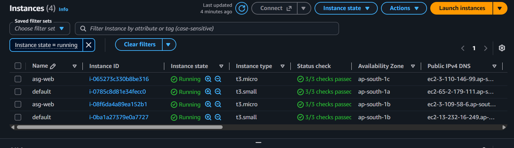
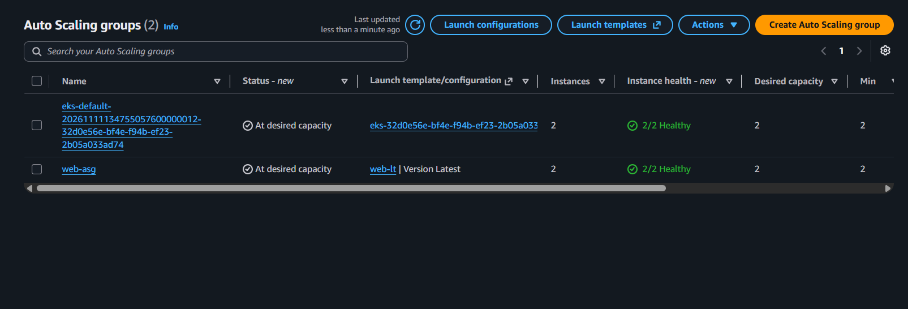
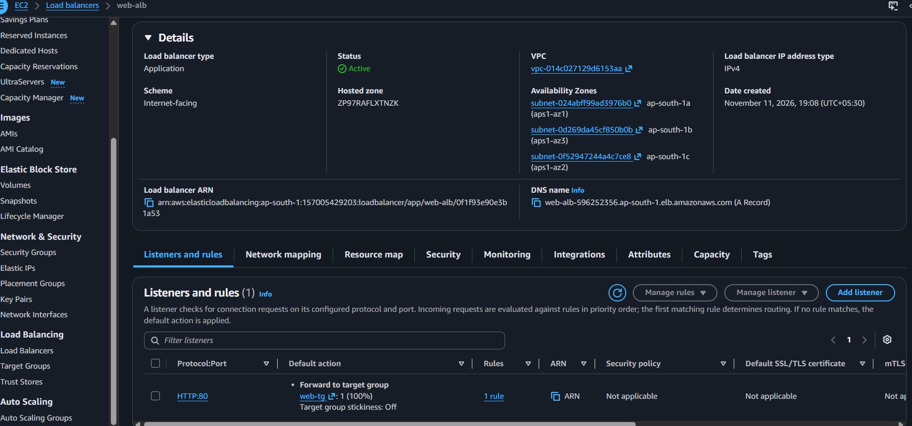
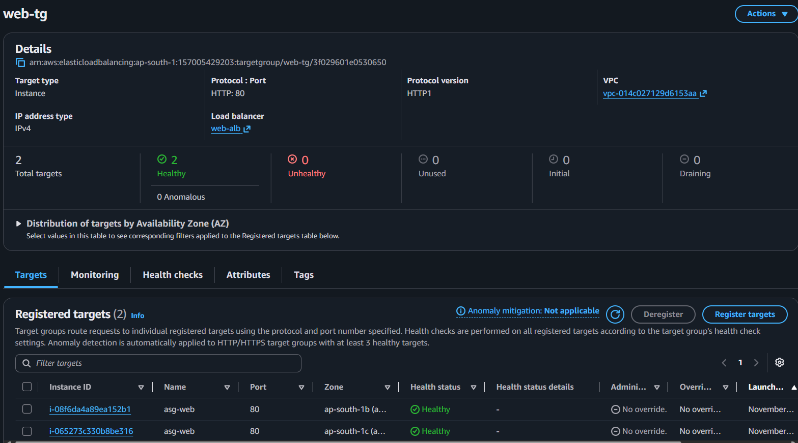
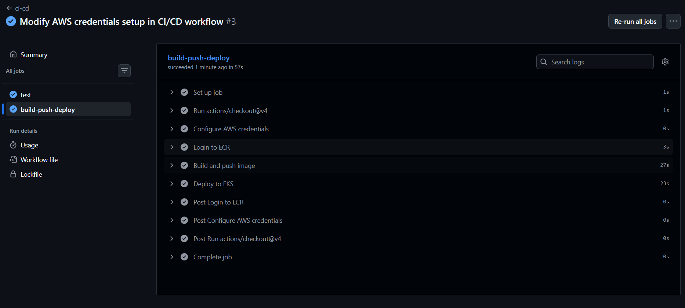
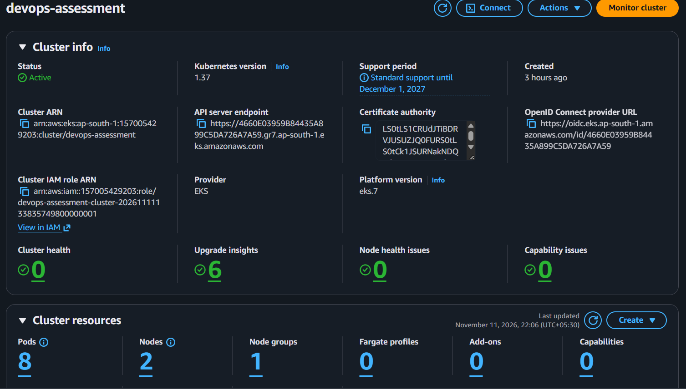
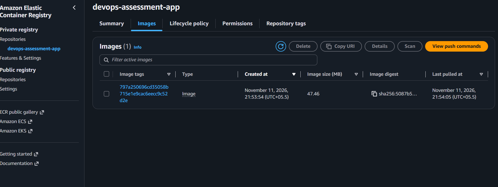
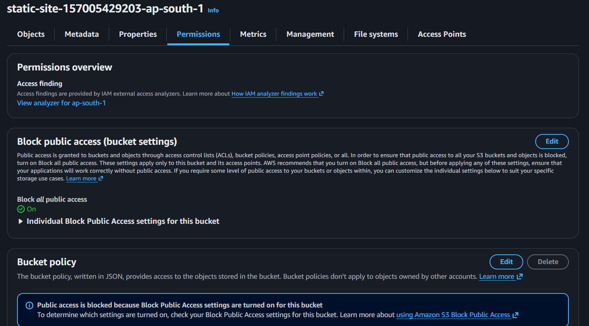

# AWS DevOps Practical Assessment

**Author:** Ayush  
**Region:** ap-south-1 (Mumbai)  
**Tools:** Terraform, GitHub Actions, Docker, Kubernetes (EKS), AWS

## What this project does

This project builds a small but complete setup on AWS that covers three tasks:

1. **CI/CD pipeline:** every push to the `main` branch automatically tests the app, builds a Docker image, stores it in AWS, and deploys it to a Kubernetes cluster.
2. **Static website with CloudFront:** a website stored in a private S3 bucket and delivered to users through CloudFront. Nobody can open the bucket directly.
3. **Auto-scaling web servers:** web servers behind a load balancer that add more servers when they get busy and replace any server that stops working.

All AWS infrastructure is created with Terraform. The application is deployed by GitHub Actions.

## What gets deployed

**Compute**
- 2 EC2 web servers (t3.micro, running nginx) managed by an Auto Scaling Group. They can grow up to 4 when CPU goes above 70%.
- 2 EC2 worker nodes (t3.small) that run the Kubernetes cluster.
- 1 Auto Scaling Group that we define for the web servers. The Kubernetes worker nodes also sit in an Auto Scaling Group that AWS manages automatically, so there are 2 in total, but only 1 is written in this project.
- 1 Launch Template that tells the Auto Scaling Group how to build each web server.

-- EC2 Instances Launched

-----------------------------------
-- Auto Scaling Groups

**Load balancing**
- 1 Application Load Balancer that shares web traffic across the web servers.
- 1 Target Group that checks whether each server is healthy.
- 1 extra load balancer that Kubernetes creates for the app (it appears after the pipeline deploys).

-- Application Loadbalancer

-----------------------------------
-- Target Groups for the ALB

**Containers and CI/CD**
- 1 ECR repository that stores the Docker images.
- 1 EKS (Kubernetes) cluster running 2 copies of the app.
- 1 IAM role and OIDC connection that lets GitHub Actions deploy to AWS without storing any access keys.

-- CI/CD Pipeline Success and All tests report
 
 
 -----------------------------------
 -- EKS Cluster Active with Pods running
 

 -----------------------------------
 -- Image Pushed to ECR
 

**Static website**
- 1 private S3 bucket holding the website files, with all public access blocked.
- 1 CloudFront distribution that serves the website over HTTPS.
- 1 Origin Access Control and bucket policy so that only CloudFront can read the bucket.

-- S3 Direct Access Blocked 

**Security and access**
- 2 security groups: one for the load balancer (open to the internet on the web port) and one for the servers (only accept traffic from the load balancer).
- 1 IAM role and instance profile for the web servers so they can be managed without SSH keys.

## How it works

**CI/CD**
When code is pushed to GitHub, a pipeline runs. It first runs the tests. If they pass, it builds the Docker image, uploads it to ECR with the commit ID as its tag, and updates the app on the Kubernetes cluster. If the tests fail, nothing is deployed.

**CloudFront and S3**
Users visit the CloudFront address. CloudFront fetches the files from the private S3 bucket and keeps copies close to users. Trying to open the S3 address directly is denied. When the website files change, Terraform uploads them and clears CloudFront's cached copies so users see the new version.

**Auto Scaling and load balancer**
The load balancer sends each visitor to one of the web servers. Every few seconds it checks that each server is healthy. If a server stops responding, the Auto Scaling Group removes it and starts a new one. If average CPU use stays above 70%, the group adds more servers, and removes them again when it is quiet.

## What the project proves

- Infrastructure can be created and removed with code (Terraform).
- Code changes are tested and deployed automatically (GitHub Actions).
- The S3 bucket stays private and is only reachable through CloudFront.
- The web servers scale out under load and heal themselves when one fails.

## Folder guide

- **terraform:** all AWS infrastructure
- **app:** the small web application and its Docker file
- **k8s:** Kubernetes files used by the pipeline
- **.github/workflows:** the CI/CD pipeline
- **site:** the static website files
- **demos:** helper scripts to show scaling and server replacement
- **docs:** plain-English explanation of the project

